# The Serve Archive: rebuilding tennis dresses from match photos

[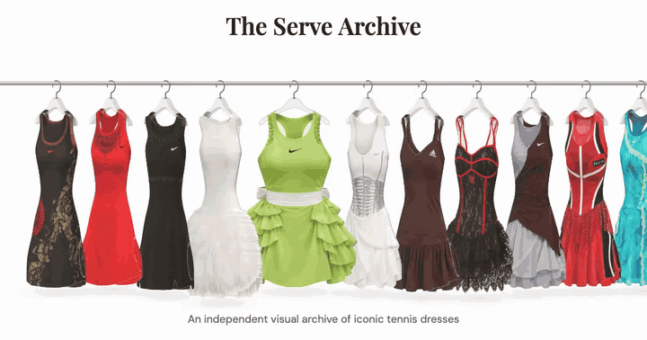](https://www.servearchive.com/)

[The Serve Archive](https://www.servearchive.com/) is a museum-style catalogue of memorable tennis dresses, from the 1910s to the 2026 season. Every garment is shown the same way: empty, straight on, front and back, on the same warm-grey paper.

None of those garments were photographed like that. They exist in match photos, mid-swing, half hidden by an arm or a racket, often in black and white, and almost always owned by a photo agency. This is how I turned those photos into a consistent catalogue with AI image generation, and the rules that keep it honest.

**In numbers:** 175 looks, 173 back views (13 based on a photo of the back, 160 inferred and labelled as such), and one 3D pilot.

## From match photo to catalogue

Four examples. In each row: the photograph used as evidence, then the generated front and back.

  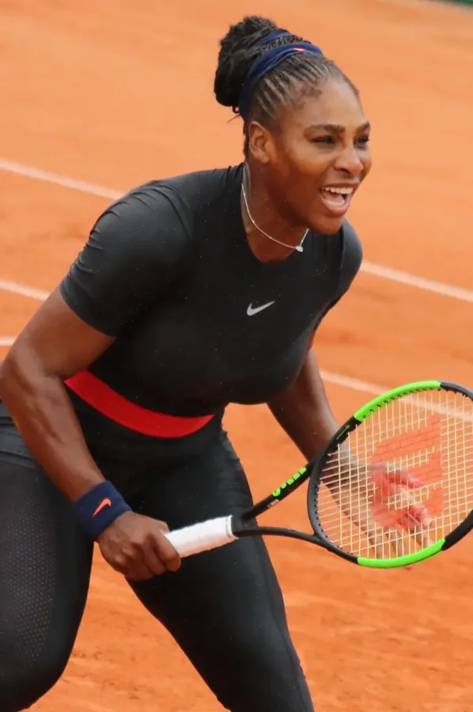
  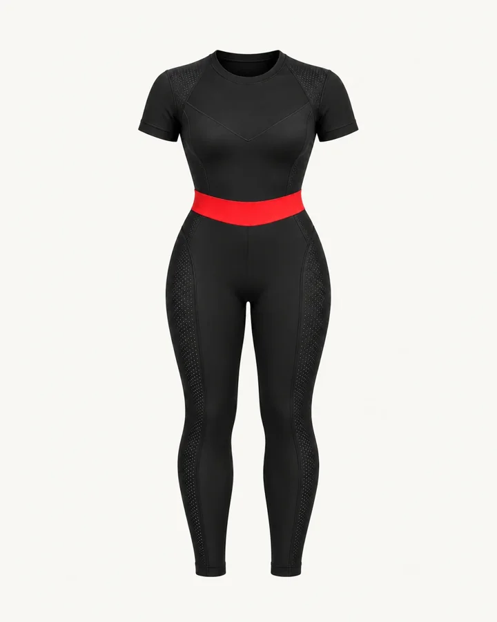
  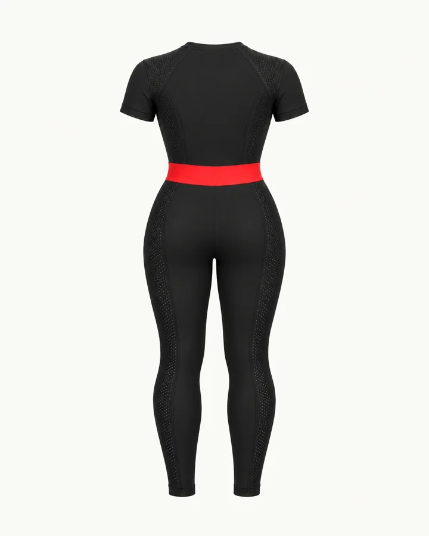

**Serena Williams, Roland-Garros 2018.** The Nike catsuit from her first Grand Slam after giving birth. Photo: si.robi, via [Wikimedia Commons](https://commons.wikimedia.org/wiki/File:Williams_S._RG18_(17)_(41168711240).jpg), [CC BY-SA 2.0](https://creativecommons.org/licenses/by-sa/2.0/), resized.

  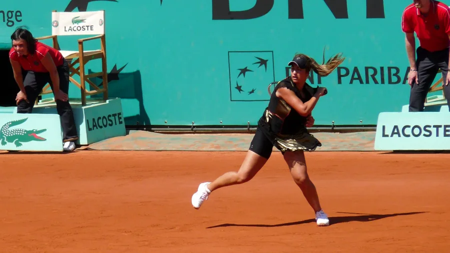
  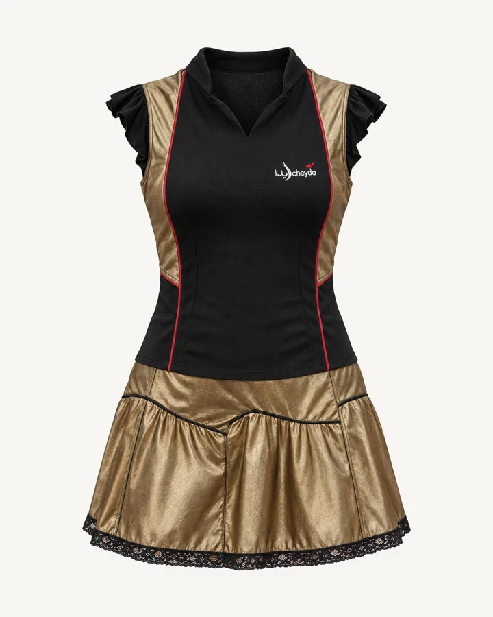
  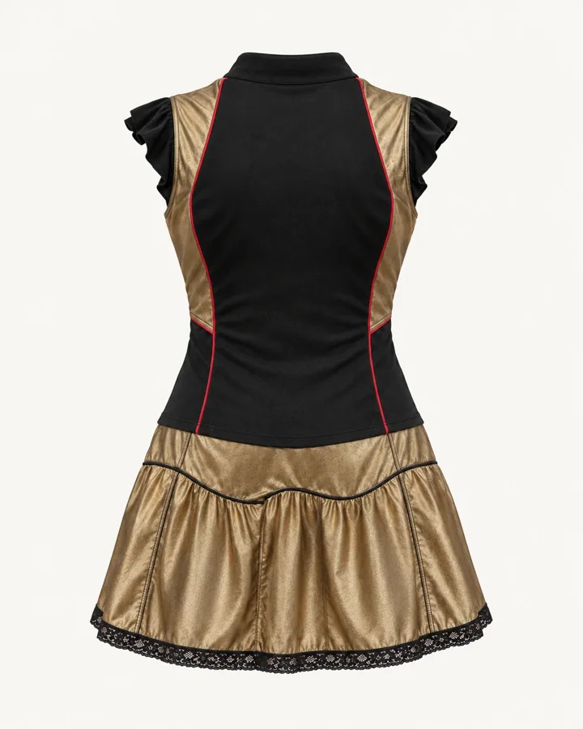

**Aravane Rezaï, Roland-Garros 2010.** Black bodice, metallic gold skirt, lace hem. The designer is not documented, so the site says so. Photo: Yann Caradec, via [Wikimedia Commons](https://commons.wikimedia.org/wiki/File:Aravane_Rezai_Roland_Garros_2010_R1.jpg), [CC BY-SA 2.0](https://creativecommons.org/licenses/by-sa/2.0/), resized. [See the prompts](process/prompts/rezai-rg-2010.md).

  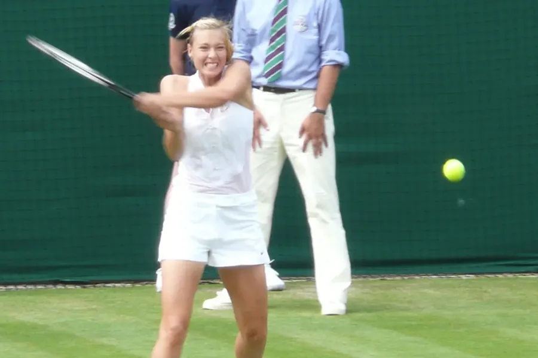
  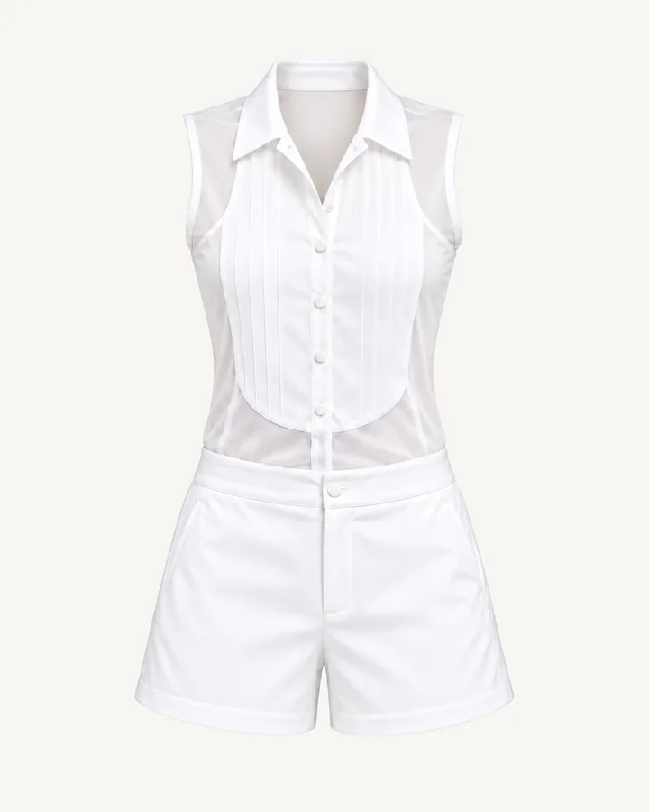
  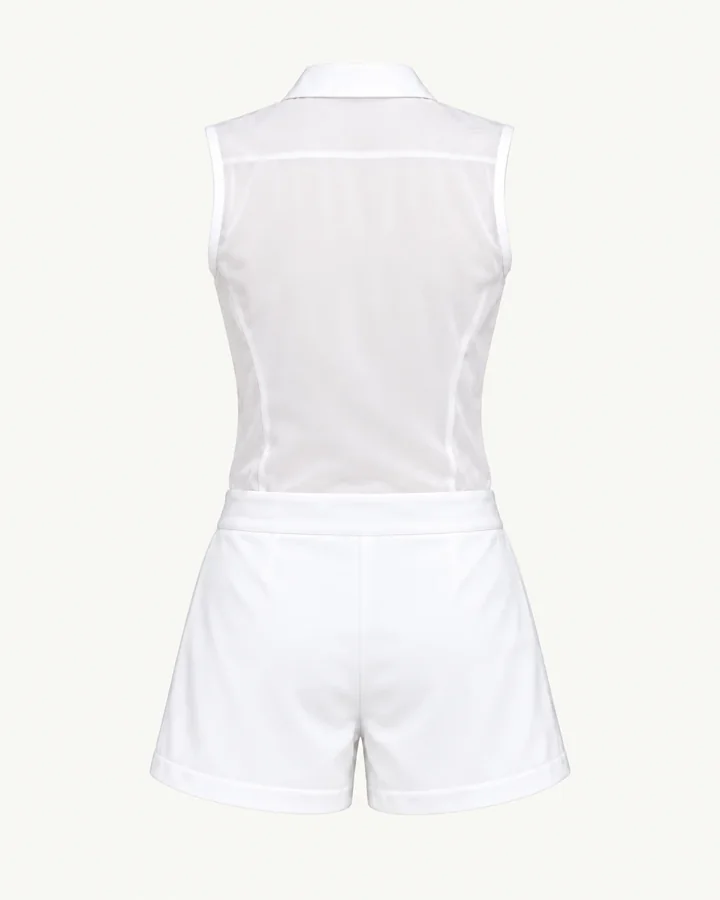

**Maria Sharapova, Wimbledon 2008.** A pleated tuxedo bib and tailored shorts instead of a dress. Photo: Barry Mangham, via [Wikimedia Commons](https://commons.wikimedia.org/wiki/File%3A252_-_Court_1_-_Maria_Sharapova.JPG), [CC BY-SA 3.0](https://creativecommons.org/licenses/by-sa/3.0/), resized.

  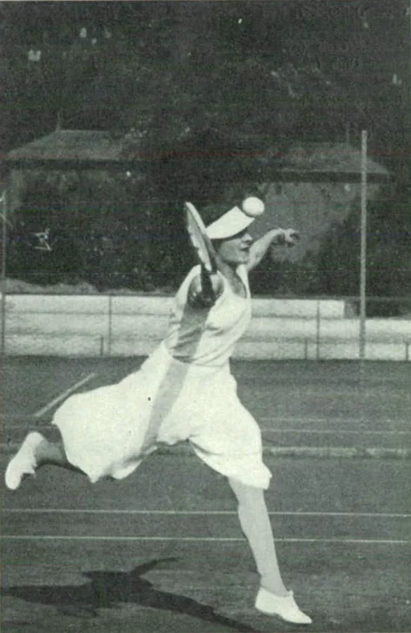
  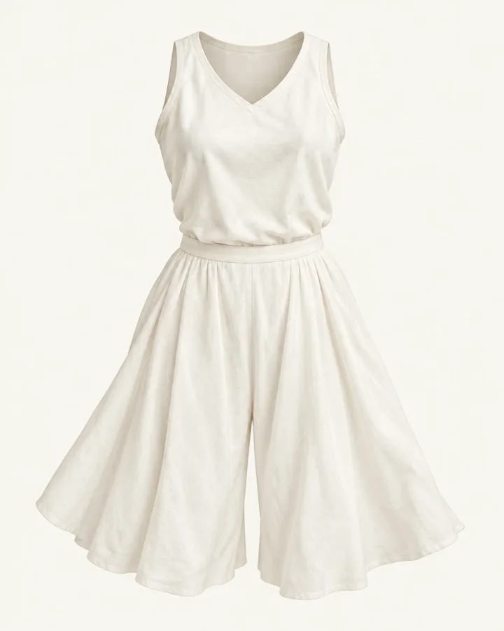
  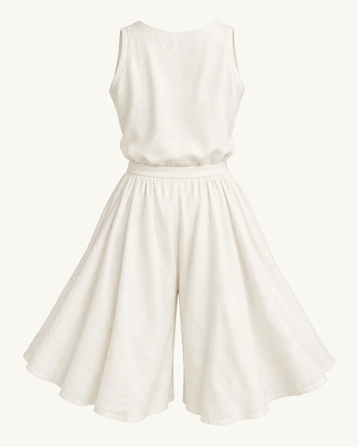

**Lilí Álvarez, Roland-Garros 1931.** Elsa Schiaparelli's divided skirt. The colour and fabric are interpreted from a black-and-white photo, and the site says that too. Photo: *Tennisz és Golf*, 24 June 1931, via [Wikimedia Commons](https://commons.wikimedia.org/wiki/File:Lil%C3%AD_%C3%81lvarez.jpg), public domain.

## How a look gets made

**1. Choose it.** Only dresses with a real design story: an unusual silhouette or construction, heavy embellishment, or something made for one player. A title win in an ordinary kit does not qualify. The full criteria are in [selection-criteria.md](process/selection-criteria.md).

**2. Check the facts.** Player, tournament, date, designer, and the exact version in the photo. Evidence is match photos and, where a garment survives, museum photos of the object, which show construction better than a player in motion. Similar outfits get mixed up online, so this step catches real errors. For Rezaï I used a Roland-Garros photo, not the similar Australian Open outfit. Bethanie Mattek-Sands's 2006 US Open look turned out to be a top and skirt, not the one-piece toga it is often described as.

**3. Generate the front.** Each prompt gets two kinds of image with strict roles. The match photo is the only source of the design: cut, colour, seams, trim, logos. A second image is used only for presentation: the empty-garment look, the light, the scale. The prompt then fixes everything else: an exact straight-on view, the garment between 15% and 85% of the canvas height, a flat warm-grey background (#f7f6f2), and no body, hanger, racket or jewellery. Generation is iterative: a first result establishes the garment, then focused passes fix framing, drape or one detail. A prompt is an instruction, not proof that every detail came out right, which is why step 6 exists. [Example prompts](process/prompts/rezai-rg-2010.md).

**4. Reconstruct the back.** Most match photos never show the back. When there is a photo of it, it is used. When there isn't, the back is rebuilt conservatively from the front and side and marked "inferred" on the site. Early backs kept coming out as fronts seen from behind, with chest shapes and front necklines, so [rules for rear views](process/rear-view-rules.md) were added after review.

**5. Make the set consistent.** A second, narrower pass fixes stance, camera angle and placement without touching the garment ([example](process/prompts/serena-rg-2018-remaster.md)). Then every front and back pair is measured and aligned to the same centre and height, without stretching. The background took several rounds to get right: one continuous paper surface, with no lighter rectangle around a garment and no lost detail in white fabric.

**6. Check before publishing.** Every image is reviewed by eye, and 14 automated checks cover the content, player pages, navigation and link previews. If a detail is uncertain, the site says so instead of guessing.

## The dress rail

The home page hangs the collection on a virtual clothing rail. You can drag along it, turn a dress to see the back, and open its page.

It is not a set of full 3D models. Each dress is its front and back image mapped onto curved surfaces built in Three.js:

- **Cut-out.** The browser removes only the background connected to the image edges, so white fabric survives.
- **Volume.** The silhouette is measured row by row and shapes a curved front and back, with a depth profile for the bodice and a skirt that opens outward.
- **Hanging.** Each dress attaches to a transparent hanger at its shoulder or strap points, not the top of the image, so it looks supported.
- **Movement.** Damped springs ease the rail into place. A small shader keeps the shoulders steady while the hem lags, drifts and ripples on a turn. It is designed motion, not a cloth simulation.
- **Performance and access.** The selected dress loads first and the rest load outward. The scene pauses off screen. Reduced-motion settings turn the movement off, and every dress has a keyboard-reachable link.

The side view is an interpretation built from the two images, not a record of the real garment. The full write-up is in [how-it-works.md](process/how-it-works.md).

**The code is in [`rail/`](rail/)** and runs locally with one command: `python3 -m http.server 8880 --directory rail`.

## Tools

- **Images:** OpenAI's image generation, run through Codex, which also helped build the site.
- **3D:** Hunyuan 3D on fal, for a one-look [pilot](process/3d-pilot.md).
- **Site:** plain HTML, CSS and JavaScript, with Three.js for the dress rail.

## About the images

The generated garments are interpretive reconstructions, not photographs of the real clothes. The four match photos in this repository are all Creative Commons or public domain, with their credits above. The live site also shows press photos for comparison, and those stay with their owners, so they are not included here.

The rail code is shared to read and run, not licensed for reuse. Three.js is included under its MIT licence.

---

Made by [Annoushka](https://www.anshka.com).
